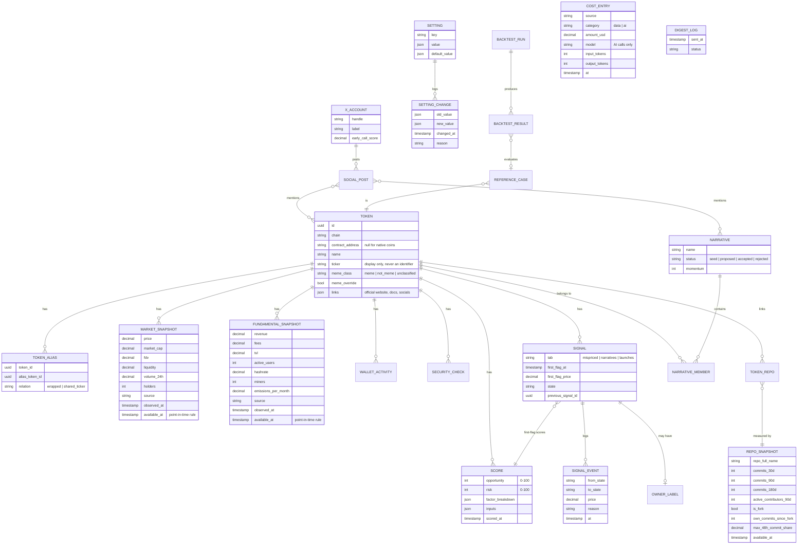

# Entity-relationship diagram

Source: ARCHITECTURE.md Section 4; PRD.md 3.2–3.13.

Every table also has `id`, `created_at` and `archived_at` (soft delete; nothing is hard-deleted). All timestamps are stored in UTC.

`COST_ENTRY` and `DIGEST_LOG` stand alone; they are referenced only by System Health (PRD 3.12).
