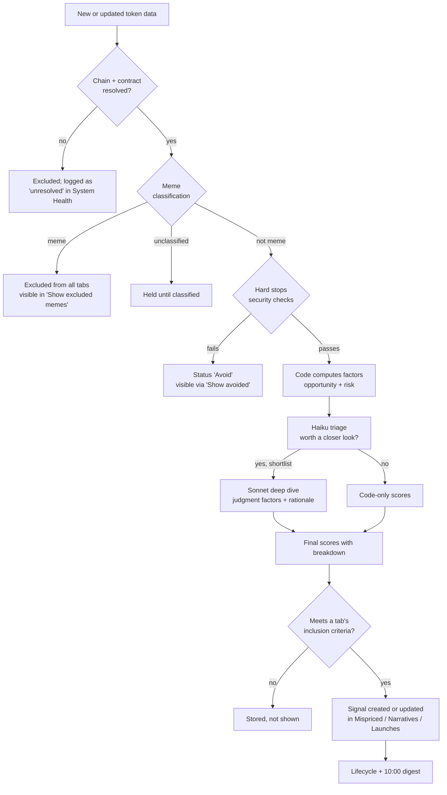

# Flow: from raw data to signal

Source: PRD.md 3.2–3.7; VISION.md (AI funnel); ARCHITECTURE.md Section 2 (AI).

Budget guard: if AI spend reaches the monthly ceiling, step H pauses and tokens keep code-only scores (PRD 3.12).
