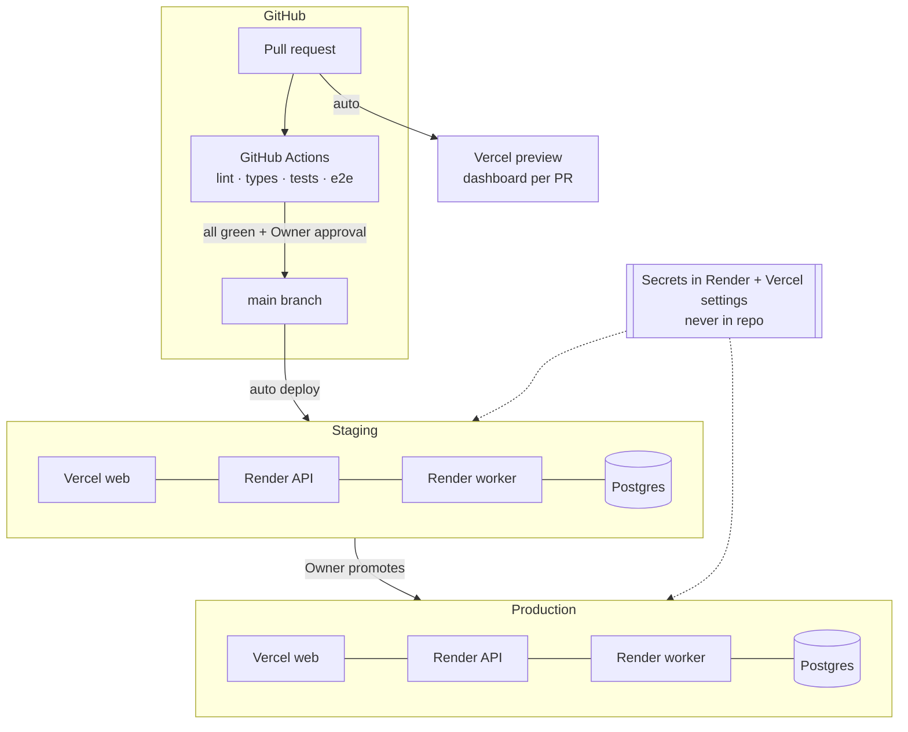

# Infrastructure and environments

Source: ARCHITECTURE.md Sections 2, 7, 8.

**Rules**
- Agents work locally and through preview only. They never hold staging or production credentials.
- Each environment has its own database, API keys and Clerk instance.
- Staging digests carry a "[STAGING]" subject prefix.
